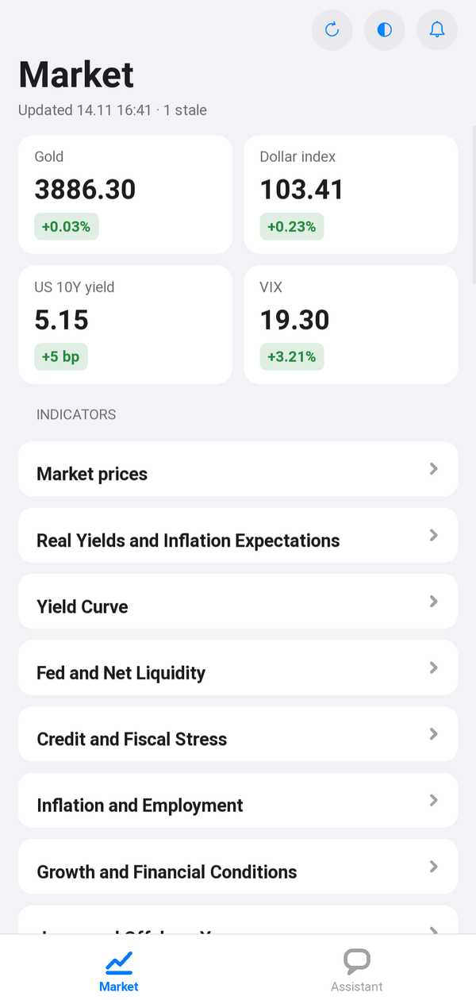
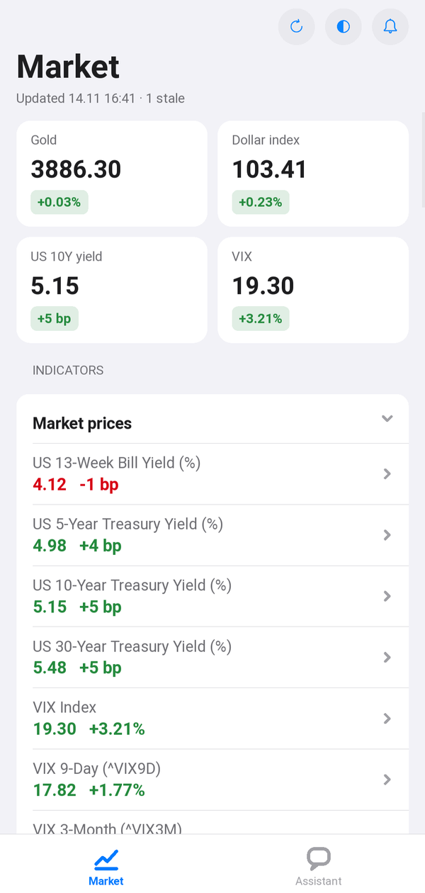
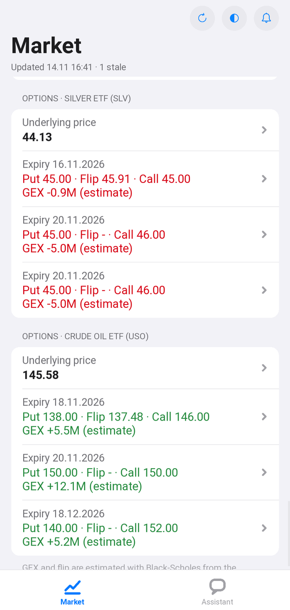
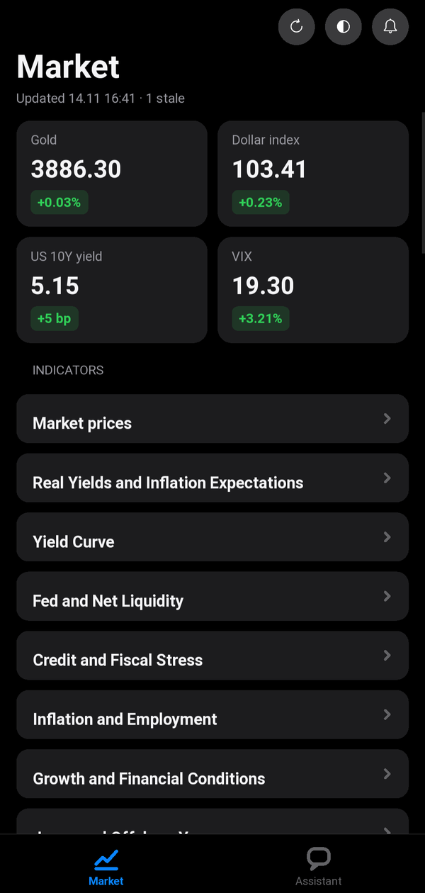
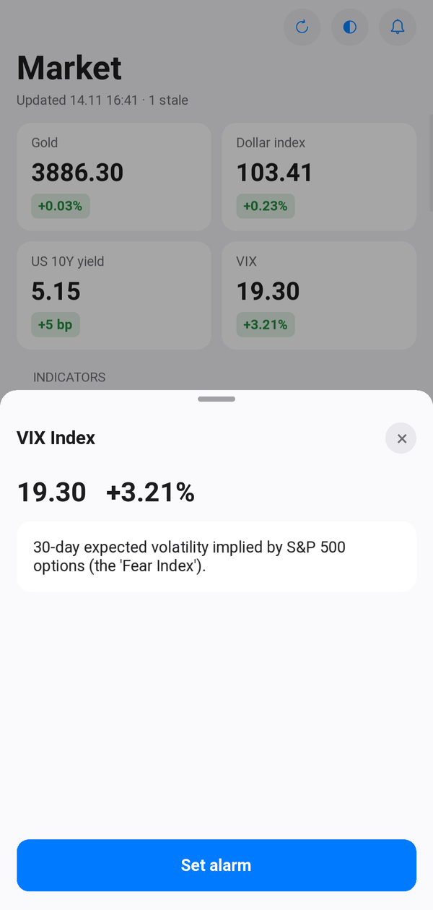
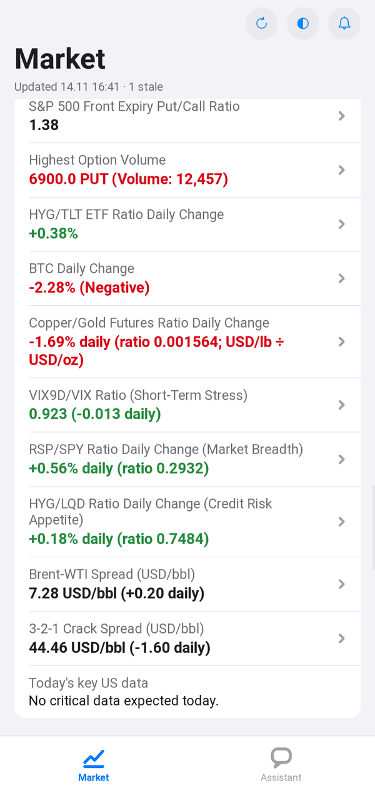
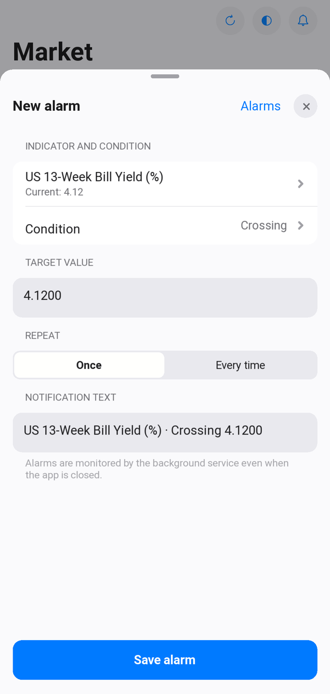
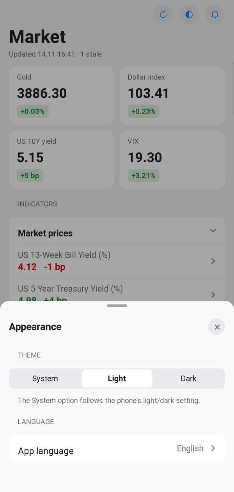
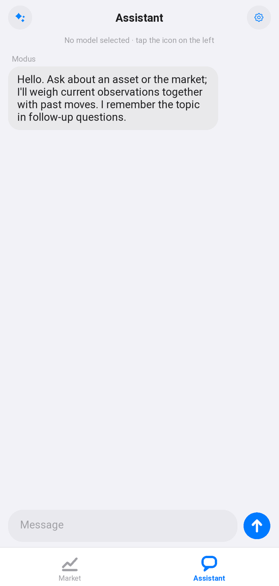
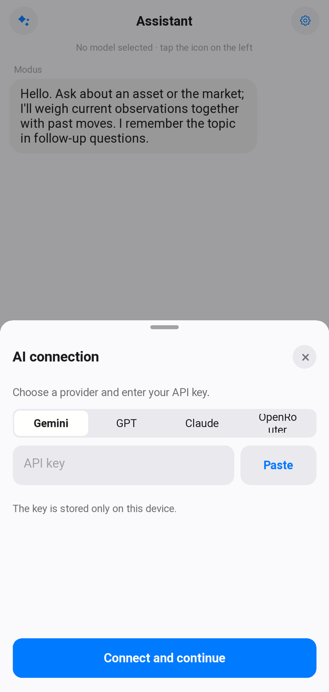

# Modus

An Android app that combines macro data, options positioning (GEX) and AI-assisted market commentary, available in ten languages.

> **Not investment advice.** The data and AI output shown by the app are for information and education only and may be wrong, delayed or incomplete. You are responsible for your own trading decisions.

## Install on your Android phone
The app is not on Google Play; you install the APK file directly.

1. **Check your phone.** Android 5.0 or newer on a 64-bit or 32-bit ARM processor (almost every phone sold in recent years).
2. **Download the APK.** On your phone, open the [latest release](https://github.com/nuiaa/Modus2/releases/latest) and tap the file named `borsaradar-…-debug.apk` under **Assets**. You can also build it yourself (see [Android APK](#android-apk) below) and copy it to the phone over USB.
3. **Allow the install.** When you open the downloaded file, Android asks for permission to install apps from that source (for example Chrome or Files). Tap **Settings**, turn on **Allow from this source**, then go back.
4. **Install.** Tap **Install**. If Google Play Protect warns that the app is from an unknown developer, choose **More details → Install anyway**; the APK is signed with a development key, not a Play Store key.
5. **First launch.** Open **Modus Sync**, allow notifications so price alarms can reach you, and wait a few seconds while market data loads. To use the assistant, enter your own AI provider key (see [AI key](#ai-key)).

**Updating:** install the new APK over the old one; your alarms and settings are kept. If Android says the app conflicts with an existing package, the new file was signed on a different computer: uninstall the old version first (this deletes its alarms and settings).

<p>
  
  
  
  
</p>
<p>
  
  
  
  
</p>
<p>
  
  
</p>

## Features
- Prices, volatility and macro indicators for gold, silver, oil, the S&P 500, Bitcoin and the dollar index
- Estimated put/call walls, gamma flip and net GEX from the options chain
- Macro and positioning indicators from FRED, the US Treasury, the Fed, EIA and CFTC
- Price and indicator alarms, monitored by a background service
- AI chat that receives calculated relative metrics instead of raw data (distance to moving averages, percentile and z-score, GEX levels relative to spot) and answers in the app's language
- Light, dark and system themes

## Languages
English, Turkish, German, French, Spanish, Russian, Arabic, Chinese (Simplified), Japanese and Korean. The first launch follows the device language; you can change it under **Appearance → App language**.

- Arabic is drawn right to left with joined letter forms using the bundled [IBM Plex Sans Arabic](Main/fonts/OFL.txt) font (SIL Open Font License).
- Chinese, Japanese and Korean use the CJK font that ships with Android (Noto Sans CJK on most devices).
- Translations live in `Main/locales/`: `keys.json` lists the Turkish source strings and each `<code>.json` lists the translations in the same order. `test_i18n.py` checks that every catalog is complete and keeps its `{placeholders}`.

## AI key
The app does not include an AI service. You enter your own API key in the settings; supported providers are Google Gemini, OpenAI, Anthropic and OpenRouter. The key is stored only on your device and sent directly to the provider you choose, which bills you for usage.

## Setup

### Run on the desktop
```bash
pip install -r requirements.txt
cd Main
python main.py
```

### Tests
```bash
cd Main
python -m unittest discover -p "test_*.py"
```

### Android APK
The APK is built with [Buildozer](https://buildozer.readthedocs.io/) on WSL (Ubuntu):
```bash
bash Main/build_native.sh
```
On Windows, `Main/APK_Guncelle_Derle.bat` runs the same script through WSL. The output is copied to the `APK/` folder.

### Desktop tools (optional)
`Main/sabah_duvarlari.py` and `Main/streamlit_app.py` are desktop tools separate from the app and need extra packages (`yfinance`, `pandas`, `numpy`, `scipy`, `rich`, `streamlit`). `sabah_duvarlari.py` expects COMEX warehouse reports in `Main/Comex_Verileri/`; download them from CME yourself, they are not part of the repository.

## Data sources
Data is fetched directly from the sources by the device running the app; this repository does not contain or redistribute any market data. Each source's terms of use apply, and some do not allow commercial use.

| Source | Used for |
|---|---|
| Yahoo Finance (unofficial endpoint) | Prices, indices, options chains |
| FRED, Federal Reserve Bank of St. Louis | Rates, inflation expectations, liquidity series |
| U.S. Treasury (Fiscal Data, TreasuryDirect) | TGA balance, auctions |
| Federal Reserve | FOMC calendar |
| U.S. EIA | Energy inventories |
| CFTC | Commitments of Traders reports |
| CME Group, Cboe | Warehouse stocks, volatility indices, put/call ratios |
| Japan Ministry of Finance | JGB yields |
| SPDR Gold Shares, iShares | GLD/SLV physical metal holdings |
| Caldara & Iacoviello GPR | Geopolitical risk index |
| DefiLlama, Binance, Bybit | Stablecoin supply, funding rates |
| ForexFactory, CNBC | Economic calendar, headlines |

## License
[GNU General Public License v3.0](LICENSE). If you modify and distribute the code, you must release your changes under the same license. The bundled Arabic font is licensed separately under the [SIL Open Font License 1.1](Main/fonts/OFL.txt).
